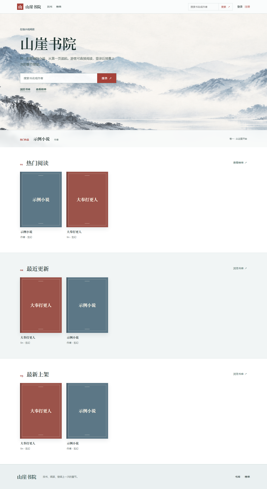
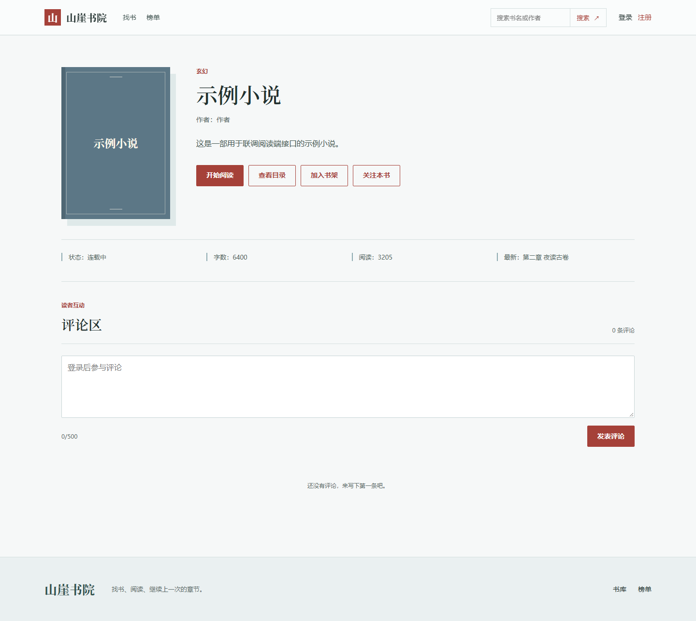

# 山崖书院 · 全栈小说阅读平台

一套前后端分离的小说阅读平台，包含 **读者站（PC Web）**、**内容管理端**、**移动端 App** 和 **Spring Boot 后端**，
并附带一套已在 Ubuntu 上落地过的部署方案（Nginx + systemd + HTTPS + 私有 OSS + 定时备份）。

> 说明：读者站的页面骨架基于开源项目 [novel-front-web](https://github.com/201206030/novel-front-web) 二次开发，
> 做了大规模裁剪与重写（移除作家后台、新闻、支付等未实现模块，重做首页/阅读页/书架等）；
> 后端、管理端、移动端、投稿审核链路与部署方案均为本项目自研。

---

## 1. 功能概览

### 读者站 `novel-front-web`（:1024）

| 模块 | 能力 |
| --- | --- |
| 书库 | 首页推荐位、分类筛选、书名/作者搜索、连载/完结过滤、三种榜单 |
| 阅读 | 章节目录分页、正文阅读、上一章/下一章、阅读进度自动同步、日夜主题 |
| 互动 | 作品评论、二级回复、评论软删除、关注作品并提示更新 |
| 个人中心 | 注册登录（图形验证码）、资料编辑、书架、阅读历史、我的评论 |
| 私人导入 | 上传 ≤20 MB TXT，自动识别 UTF-8 / GB18030 编码与“第 N 章”标题拆章，仅本人可见 |
| 投稿 | 从私人作品发起公开投稿，填写书名/笔名/分类与发布权声明，等待审核 |

### 内容管理端 `novel-front-manger`（:1025）

投稿列表与详情预览、审核通过 / 退稿（退稿可改资料重投）、撤回申请审批、主动下架、审核日志。
管理员使用独立账号体系与独立 JWT 密钥，与读者账号完全隔离。

### 移动端 `novel-front-app`（:1026，uni-app）

复用同一套后端接口，覆盖书库、榜单、阅读、书架、历史、关注、TXT 导入与投稿，
支持 H5 与 Android 打包；游客模式下可静默浏览公开内容。

---

## 2. 架构

```
┌──────────────┐  ┌──────────────┐  ┌──────────────┐
│ 读者站 Vue3  │  │ 管理端 Vue3  │  │ App uni-app  │
│   :1024      │  │   :1025      │  │   :1026      │
└──────┬───────┘  └──────┬───────┘  └──────┬───────┘
       │   /api (Nginx 去前缀 / Vite 代理)  │
       └───────────────┬─┴─────────────────┘
                       ▼
        ┌────────────────────────────────┐
        │  Spring Boot 3.3 (Java 17)     │
        │  Interceptor + ThreadLocal 鉴权 │
        │  Controller → Service → Mapper │
        └───┬───────────┬────────────┬───┘
            ▼           ▼            ▼
         MySQL 8      Redis       阿里云 OSS
        (业务数据)  (验证码/热点缓存)  (封面私有桶)
```

**接口约定**：统一响应 `{ code, data, message }`，成功码 `00000`；token 过期返回 `A0230`，
前端据此清理登录态；认证头为 `Authorization: <JWT>`（无 `Bearer` 前缀）。

---

## 3. 技术栈

| 层 | 技术 |
| --- | --- |
| 后端 | Java 17、Spring Boot 3.3、Spring Web、Validation、Spring Security（BCrypt） |
| 持久层 | MyBatis XML（手写 SQL + 显式字段映射）、MyBatis-Plus 3.5.5、MySQL 8 |
| 缓存 | Redis 7 + 自封装 `JsonRedisCache`（TTL、JSON 序列化、故障降级） |
| 认证 | JJWT 0.11.5，读者/管理员双密钥；图形验证码存 Redis |
| 读者站 | Vue 3.2、Vue Router 4、Vue CLI 5、Element Plus、Axios |
| 管理端 | Vue 3.5、Vite 6、Element Plus、Lucide Icons |
| App | uni-app (Vue 3)、Vite 5，H5 + Android |
| 部署 | Ubuntu 24.04、Nginx、systemd、Certbot、私有 OSS + 定时异地备份 |

规模：后端约 4700 行 Java（115 个类）+ 2500 行 Mapper XML，前端约 3300 行 Vue/JS。

---

## 4. 值得一看的设计点

- **热点读降级**：章节正文、首页、分类、榜单走 Redis 短 TTL 缓存；Redis 异常时自动回退查库，
  不影响主链路。公开接口每次仍校验作品是否下架，避免缓存绕过下架。
- **审核即复制**：投稿通过时，在单个数据库事务内把私人章节与正文复制为公开副本，
  私人原件与公开作品互不影响；删除原件不破坏已发布内容。
- **越权防护**：私人作品的所有读写（详情、目录、正文、进度、删除）都在 SQL / 服务层校验
  `user_id` 归属，他人的作品与不存在的作品统一返回同一个错误码，避免 ID 探测。
- **鉴权分层**：拦截器 + ThreadLocal 上下文，`afterCompletion` 强制清理；管理员与读者两套
  token 密钥，管理员接口独立拦截。
- **解析健壮性**：TXT 导入依次尝试 UTF-8 BOM / UTF-8 / GB18030，拒绝二进制与空文件，
  标题识别失败时退化为单章，最多 5000 章。
- **上线加固**：MySQL/Redis 只监听 127.0.0.1，安全组仅开 80/443，应用使用最小权限数据库账号，
  systemd 托管 + 环境变量注入密钥，数据每日备份并推送到独立 OSS 桶。

---

## 5. 目录结构

```
docs/                  接口、数据库、整体设计、迁移 SQL、OpenAPI 描述
deploy/ubuntu/         Nginx / systemd / 备份脚本模板
novel_web/novel/       Maven 多模块后端
  novel-pojo/          Entity / DTO / VO
  novel-common/        响应、异常、JWT、拦截器、Redis 工具
  novel-service/       Controller / Service / Mapper XML
novel-front-web/       读者站
novel-front-manger/    管理端
novel-front-app/       移动端
```

---

## 6. 本地启动

需要 JDK 17、Maven、Node.js、MySQL 8；注册验证码功能需要 Redis。

```bash
# 1. 初始化数据库（新库，脚本含 DROP TABLE）
mysql -uroot -p < docs/reader-database.mysql.sql
mysql -uroot -p < docs/reader-private-import-migration.mysql.sql
mysql -uroot -p < docs/reader-publication-migration.mysql.sql

# 2. 后端
cd novel_web/novel && mvn -DskipTests install
cd novel-service && mvn spring-boot:run     # http://localhost:8080

# 3. 读者站
cd novel-front-web && npm install && npm run serve     # http://localhost:1024

# 4. 管理端（首次启动后端前设置管理员账号与 JWT 密钥）
cd novel-front-manger && npm install && npm run dev     # http://127.0.0.1:1025

# 5. 移动端
cd novel-front-app && npm install && npm run dev:h5     # http://127.0.0.1:1026
```

管理员首次初始化需要设置 `NOVEL_ADMIN_BOOTSTRAP_USERNAME`、`NOVEL_ADMIN_BOOTSTRAP_PASSWORD`、
`NOVEL_ADMIN_JWT_SECRET`（≥32 字节）。生产环境使用 `application-prod.yml`，全部凭据走环境变量。

更多细节见 [`docs/development-guide.md`](docs/development-guide.md)，接口清单见
[`docs/reader-api.md`](docs/reader-api.md)，部署步骤见 [`deploy/ubuntu/README.md`](deploy/ubuntu/README.md)。

---

## 7. 界面预览

| 首页 | 作品详情 | 阅读页 |
| --- | --- | --- |
|  |  |  |

移动端适配：

---

## 8. 已知限制与后续计划

- 单元测试覆盖集中在导入解析、审核服务与 Mapper，缺少端到端接口测试（计划补 Testcontainers）。
- 热点缓存为「先失效再加载」，高并发下存在缓存击穿窗口（计划加互斥锁 / 逻辑过期）。
- 登录接口暂无失败次数限制（计划接入 Redis 计数限流）。
- 尚未提供 Docker Compose 一键起环境与 CI 流水线。
